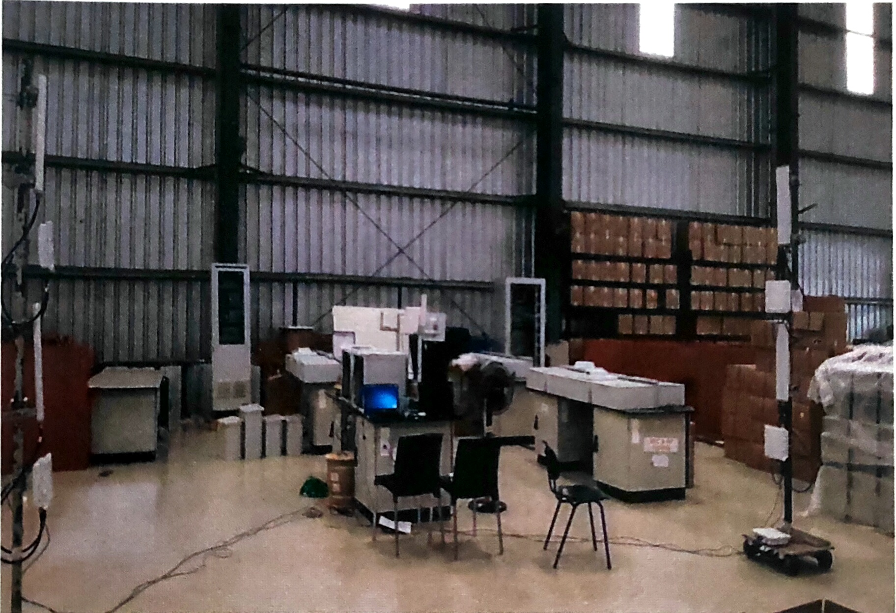
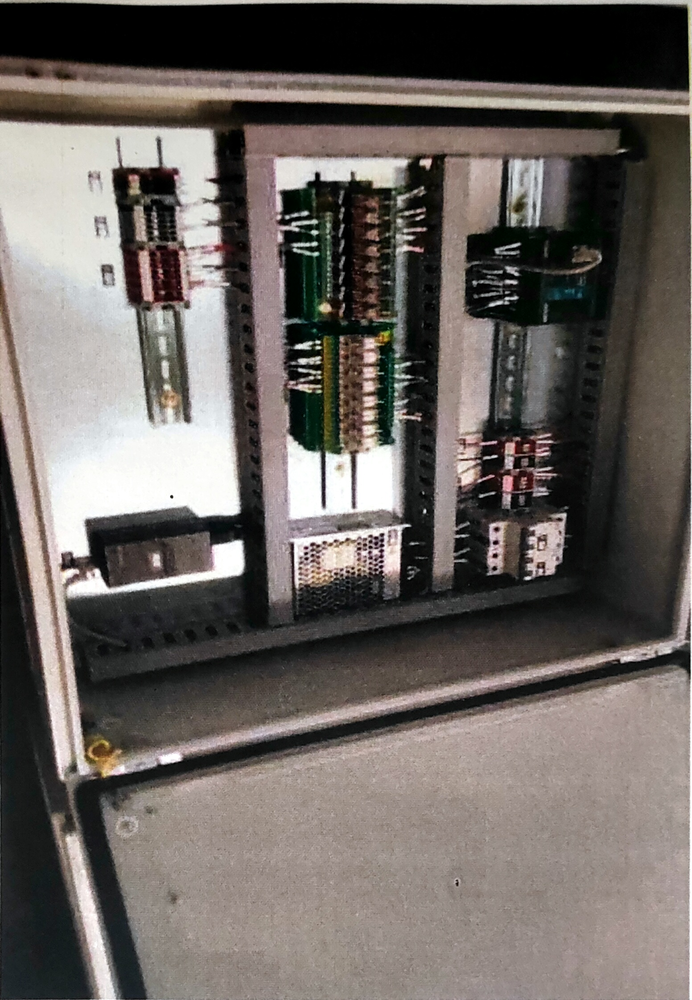

# WCS – Wireless Communication I/O Transfer System

## Project Gallery

---

## Project Overview

The Wireless Communication I/O Transfer System (WCS) is an industrial communication system designed to transfer input and output signals between remote locations through wireless communication.

I gained hands-on industrial exposure to this system during my six-month diploma internship at **Lotus Wireless**, working in the presence and under the guidance of an industry professional.

## Areas of Exposure

- Serial and Ethernet-based Radio Modems
- LRS5100 Configuration
- Point-to-Point and Point-to-Multipoint Communication
- Remote Terminal Units (RTUs)
- SCADA Communication
- FATEK FBS Series PLC
- Digital Inputs and Outputs
- WinPro Ladder Software
- PCB Types, SMT, Soldering and Testing

## My Role and Experience

- Participated in industrial project activities under professional guidance.
- Gained hands-on exposure to wireless communication equipment.
- Observed and explored RTUs, PLCs, radio modems and I/O transfer systems.
- Learned about industrial communication and automation workflows.

## Key Learning Outcomes

- Industrial Wireless Communication
- PLC and RTU Fundamentals
- SCADA Concepts
- Industrial Automation
- Hardware Interfacing
- PCB Assembly and Testing Fundamentals

## Project Details

| Category | Details |
|---|---|
| Organisation | Lotus Wireless |
| Duration | Six Months |
| Context | Diploma Final-Semester Internship |
| Project Type | Industrial Hands-on Exposure |
| Domain | Industrial Communication and Automation |

---

**Note:** This repository contains project documentation and photographs. It does not contain source code.
